# Limpieza, Análisis Exploratorio y Modelos de Probabilidad de la Base de Datos de Restaurantes (USA)

**Universidad Cooperativa de Colombia – Pasto**
**Trabajo en equipo:** Andrés, Mora, Niko, Tefa y Camilo
**Herramientas:** Python, pandas, NumPy, Matplotlib, Seaborn, SciPy (Google Colab)
**Archivos:** `base_datos_restaurantes_USA_v2.csv` → `chicofiel.py` → `base_datos_restaurantes_LIMPIA.csv`

---

## Tabla de contenido

1. [Introducción y objetivo](#1-introducción-y-objetivo)
2. [Librerías y configuración](#2-librerías-y-configuración)
3. [Carga de la base de datos](#3-carga-de-la-base-de-datos)
4. [Limpieza de datos por integrante](#4-limpieza-de-datos-por-integrante)
   - [4.1 Andrés – Identificación](#41-andrés--identificación)
   - [4.2 Mora – Demográficos](#42-mora--demográficos)
   - [4.3 Niko – Consumo financiero](#43-niko--consumo-financiero)
   - [4.4 Tefa – Fidelización](#44-tefa--fidelización)
   - [4.5 Camilo – Contacto y pagos](#45-camilo--contacto-y-pagos)
5. [Ensamblaje final](#5-ensamblaje-final)
6. [Reconocimiento de los datos](#6-reconocimiento-de-los-datos)
7. [Exportación de la base limpia](#7-exportación-de-la-base-limpia)
8. [Estadísticos de comparación y gráficos](#8-estadísticos-de-comparación-y-gráficos)
9. [Resumen de decisiones de limpieza](#9-resumen-de-decisiones-de-limpieza)
10. [Conclusiones de la limpieza y el análisis exploratorio](#10-conclusiones-de-la-limpieza-y-el-análisis-exploratorio)
11. [Fase II: Probabilidad](#11-fase-ii-probabilidad)
    - [11.1 Fórmulas utilizadas](#111-fórmulas-utilizadas)
    - [11.2 Resultados por ejercicio](#112-resultados-por-ejercicio)
    - [11.3 Resumen de la Fase II](#113-resumen-de-la-fase-ii)
    - [11.4 Conclusión de la Fase II](#114-conclusión-de-la-fase-ii)
12. [Etapa 3: Modelos de probabilidad](#12-etapa-3-modelos-de-probabilidad)
    - [12.1 Distribución uniforme (edad)](#121-distribución-uniforme-continua-edad)
    - [12.2 Distribución de Poisson (frecuencia de visita)](#122-distribución-de-poisson-frecuencia-de-visita)
    - [12.3 TLC y prueba de hipótesis (gasto)](#123-distribución-normal-teorema-del-límite-central-y-prueba-de-hipótesis-gasto-en-comida)
13. [Conclusiones generales y recomendaciones](#13-conclusiones-generales-y-recomendaciones)

---

## 1. Introducción y objetivo

El objetivo de este trabajo es **limpiar, estandarizar y explorar** una base de datos de clientes de restaurantes de Estados Unidos (`base_datos_restaurantes_USA_v2.csv`, **30 000 registros y 17 variables**) y, a partir de la base limpia, **calcular probabilidades y ajustar modelos estadísticos** que describan el comportamiento de los clientes.

El trabajo tiene tres partes:

| Parte | Contenido | Secciones |
|---|---|---|
| Fase I | Limpieza de datos, reconocimiento y gráficos descriptivos | 2 a 10 |
| Fase II | Probabilidad clásica, condicional e independencia (ejercicios a – j) | 11 |
| Etapa 3 | Distribución uniforme, Poisson, Teorema del Límite Central y prueba de hipótesis | 12 |

La limpieza (Fase I) se dividió en **cinco módulos**, uno por integrante, cada uno encargado de un grupo de variables:

| Integrante | Módulo | Variables |
|---|---|---|
| Andrés | Identificación | `id_persona`, `nombre`, `apellido`, `genero` |
| Mora | Demográficos | `edad`, `ciudad_residencia`, `estrato_socioeconomico` |
| Niko | Consumo financiero | `promedio_gasto_comida`, `frecuencia_visita`, `ocio` |
| Tefa | Fidelización | `preferencias_alimenticias`, `consume_licor`, `membresia_premium` |
| Camilo | Contacto y pagos | `telefono_contacto`, `correo_electronico`, `tipo_de_pago_mas_usado`, `ingresos_mensuales` |

Cada módulo se implementó como una **función independiente** que recibe el DataFrame, aplica las transformaciones y lo devuelve limpio. Al final, todas se ensamblan en un único flujo.

---

## 2. Librerías y configuración

Se importan las librerías para manipulación de datos (`pandas`, `numpy`), visualización (`matplotlib`, `seaborn`) y estadística (`scipy.stats`). Además, se define un tema visual de cuadrícula para todos los gráficos.

```python
import pandas as pd
import numpy as np
import matplotlib.pyplot as plt
import seaborn as sns
import scipy.stats as stats

sns.set_theme(style="whitegrid")
```

---

## 3. Carga de la base de datos

Se lee el archivo CSV y se crea una **copia de trabajo** (`df_limpio`) para conservar intacto el DataFrame original (`df`).

```python
# BASE DE DATOS
df = pd.read_csv('base_datos_restaurantes_USA_v2.csv')
df_limpio = df.copy()

print("Base de datos cargada. Filas y columnas originales:", df_limpio.shape)
```

---

## 4. Limpieza de datos por integrante

### 4.1 Andrés – Identificación

**Variables:** `id_persona`, `nombre`, `apellido`, `genero`

**Tarea:** como estas variables no tienen nulos, se realiza una limpieza de **consistencia** (estandarización de texto).

**Pasos:**
1. Eliminar espacios accidentales al inicio y al final (`str.strip()`).
2. Convertir nombres y apellidos a formato título (`str.title()`): `"JUAN PEREZ"` → `"Juan Perez"`.
3. Capitalizar el género (`str.capitalize()`): `"masculino"` → `"Masculino"`, evitando categorías duplicadas en los gráficos.

```python
def limpieza_andres(data):
    # Variables: id_persona, nombre, apellido, genero
    # Como no hay nulos, hacemos limpieza de consistencia (Estandarización de texto)

    # 1. Eliminar espacios en blanco accidentales al inicio o final de las palabras
    data['nombre'] = data['nombre'].str.strip()
    data['apellido'] = data['apellido'].str.strip()
    data['genero'] = data['genero'].str.strip()

    # 2. Formato Título: convierte "juan perez" o "JUAN PEREZ" a "Juan Perez"
    data['nombre'] = data['nombre'].str.title()
    data['apellido'] = data['apellido'].str.title()

    # 3. Capitalizar el género ("masculino" -> "Masculino") para evitar duplicados en los gráficos
    data['genero'] = data['genero'].str.capitalize()

    print("Andrés: Datos de identificación verificados y estandarizados.")
    return data
```

---

### 4.2 Mora – Demográficos

**Variables:** `edad`, `ciudad_residencia`, `estrato_socioeconomico`

**Tarea:** reemplazar los nulos de `edad` con la **mediana**.

**Pasos:**
1. **Valores imposibles:** edades menores a 18 o mayores a 100 (por ejemplo `-5` o `300`) se convierten en `NaN` para que no distorsionen la mediana.
2. **Imputación:** se calcula la mediana solo con datos válidos y se rellenan los nulos; luego se convierte la columna a entero.
3. **Estandarización categórica:** se eliminan espacios en `ciudad_residencia` y se aplica formato título a `estrato_socioeconomico`.

> **¿Por qué la mediana?** Es robusta frente a valores extremos, a diferencia de la media.

```python
def limpieza_mora(data):
    # Variables: edad, ciudad_residencia, estrato_socioeconomico
    # TAREA: Reemplazar nulos de 'edad' con la mediana o media

    # 1) Edades imposibles (-5, 300) -> NaN, para que no distorsionen la mediana
    data.loc[(data['edad'] < 18) | (data['edad'] > 100), 'edad'] = float('nan')

    # 2) Imputar nulos de 'edad' con la mediana (calculada solo con datos válidos)
    mediana_edad = data['edad'].median()
    data['edad'] = data['edad'].fillna(mediana_edad).astype(int)

    # 3) Estandarizar variables categóricas de ubicación y estrato
    data['ciudad_residencia'] = data['ciudad_residencia'].str.strip()
    data['estrato_socioeconomico'] = data['estrato_socioeconomico'].str.strip().str.title()

    print("Mora: Limpieza demográfica aplicada.")
    return data
```

---

### 4.3 Niko – Consumo financiero

**Variables:** `promedio_gasto_comida`, `frecuencia_visita`, `ocio`

**Pasos:**
1. **Nulos en `promedio_gasto_comida`:** se imputan con la mediana de la columna.
2. **Valores inconsistentes en `frecuencia_visita`:** se detectaron valores negativos (por ejemplo `-3`), que no tienen sentido para una frecuencia. Se reemplazan por la mediana de la frecuencia de visita.

```python
def limpieza_niko(data):
    # Variables: promedio_gasto_comida, frecuencia_visita, ocio

    # 1. Imputamos los valores nulos de 'promedio_gasto_comida' usando la mediana
    mediana_gasto = data['promedio_gasto_comida'].median()
    data['promedio_gasto_comida'] = data['promedio_gasto_comida'].fillna(mediana_gasto)

    # 2. Corregimos valores atípicos/inconsistentes en 'frecuencia_visita' (hay valores negativos de -3)
    # Reemplazamos los valores negativos por la mediana de la frecuencia de visita
    mediana_frecuencia = data['frecuencia_visita'].median()
    data.loc[data['frecuencia_visita'] < 0, 'frecuencia_visita'] = mediana_frecuencia

    print("Niko: Limpieza de consumo financiero aplicada (gasto imputado con mediana y frecuencias corregidas).")
    return data
```

---

### 4.4 Tefa – Fidelización

**Variables:** `preferencias_alimenticias`, `consume_licor`, `membresia_premium`

**Tarea:** reemplazar los nulos de estas variables categóricas con la **moda** (el valor más frecuente), ya que la mediana no aplica a datos cualitativos.

```python
def limpieza_tefa(data):
    # Variables: preferencias_alimenticias, consume_licor, membresia_premium
    # TAREA: Reemplazar nulos de 'preferencias_alimenticias' con la MODA (el valor más común)

    moda_preferencia = data['preferencias_alimenticias'].mode()[0]
    data['preferencias_alimenticias'] = data['preferencias_alimenticias'].fillna(moda_preferencia)

    moda_licor = data['consume_licor'].mode()[0]
    data['consume_licor'] = data['consume_licor'].fillna(moda_licor)

    moda_membresia = data['membresia_premium'].mode()[0]
    data['membresia_premium'] = data['membresia_premium'].fillna(moda_membresia)

    print("Tefa: Limpieza de preferencias aplicada.")
    return data
```

---

### 4.5 Camilo – Contacto y pagos

**Variables:** `telefono_contacto`, `correo_electronico`, `tipo_de_pago_mas_usado`, `ingresos_mensuales`

**Tarea:** unificar formatos y reemplazar nulos masivos con etiquetas descriptivas.

**Pasos:**
1. **Teléfono:** se unifica al formato `XXX-XXX-XXXX`:
   - se elimina la extensión (`x123`),
   - se conservan solo los dígitos,
   - se toman los últimos 10 dígitos (quita prefijos `+1`, `001`, `1`),
   - si no quedan 10 dígitos, el valor se descarta (queda nulo).
2. **Correo:** sin espacios y en minúsculas.
3. **Imputación masiva:** teléfonos nulos → `"Sin registro"`; correos nulos → `"No registrado"`.
4. **Tipo de pago:** estandarización de texto (sin nulos).
5. **Ingresos mensuales:** sin nulos, negativos ni ceros (rango 800 – 17 999); no requiere cambios.

```python
def limpieza_camilo(data):
    # Variables: telefono_contacto, correo_electronico, tipo_de_pago_mas_usado, ingresos_mensuales
    # TAREA: Reemplazar nulos masivos con "No registrado" / "Sin registro"

    # 1. Teléfono: unificar formato a XXX-XXX-XXXX
    #    Se quita la extensión (x123), el prefijo de país (+1, 001, 1) y todo lo que no sea dígito
    tel = data['telefono_contacto'].str.strip()
    tel = tel.str.replace(r'[xX].*$', '', regex=True)          # extensión
    tel = tel.str.replace(r'\D', '', regex=True)               # solo dígitos
    tel = tel.str[-10:]                                        # últimos 10 (quita +1 / 001)
    tel = tel.where(tel.str.len() == 10)                       # si no tiene 10 dígitos, se descarta
    tel = tel.str[:3] + '-' + tel.str[3:6] + '-' + tel.str[6:]
    data['telefono_contacto'] = tel

    # 2. Correo: sin espacios y en minúsculas
    data['correo_electronico'] = data['correo_electronico'].str.strip().str.lower()

    # 3. Imputación masiva de medios de contacto
    data['telefono_contacto'] = data['telefono_contacto'].fillna("Sin registro")
    data['correo_electronico'] = data['correo_electronico'].fillna("No registrado")

    # 4. Tipo de pago: consistencia de texto (no tiene nulos)
    data['tipo_de_pago_mas_usado'] = data['tipo_de_pago_mas_usado'].str.strip().str.capitalize()

    # 5. ingresos_mensuales: sin nulos, negativos ni ceros (rango 800 - 17999), no requiere cambios

    print("Camilo: Limpieza de contactos aplicada (formatos unificados y nulos imputados).")
    return data
```

---

## 5. Ensamblaje final

Se ejecutan las cinco funciones en secuencia sobre el mismo DataFrame y se verifica que **ya no queden valores nulos**.

```python
# ==========================================
# ENSAMBLAJE FINAL
# ==========================================
df_limpio = limpieza_andres(df_limpio)
df_limpio = limpieza_mora(df_limpio)
df_limpio = limpieza_niko(df_limpio)
df_limpio = limpieza_tefa(df_limpio)
df_limpio = limpieza_camilo(df_limpio)

# Verificamos que ya no queden nulos
print("\n--- REVISIÓN FINAL DE DATOS NULOS ---")
print(df_limpio.isnull().sum())
```

### Resultado obtenido

```text
Base de datos cargada. Filas y columnas originales: (30000, 17)
Andrés: Datos de identificación verificados y estandarizados.
Mora: Limpieza demográfica aplicada.
Niko: Limpieza de consumo financiero aplicada (gasto imputado con mediana y frecuencias corregidas).
Tefa: Limpieza de preferencias aplicada.
Camilo: Limpieza de contactos aplicada (formatos unificados y nulos imputados).

--- REVISIÓN FINAL DE DATOS NULOS ---
id_persona                   0
nombre                       0
apellido                     0
edad                         0
genero                       0
ciudad_residencia            0
estrato_socioeconomico       0
frecuencia_visita            0
promedio_gasto_comida        0
ocio                         0
consume_licor                0
preferencias_alimenticias    0
membresia_premium            0
telefono_contacto            0
correo_electronico           0
tipo_de_pago_mas_usado       0
ingresos_mensuales           0
dtype: int64
```

**Interpretación:** la base original tiene **30 000 registros y 17 variables**. Tras aplicar las cinco funciones de limpieza, **ninguna columna tiene valores nulos**, por lo que el proceso de imputación fue exitoso.

---

## 6. Reconocimiento de los datos

Una vez limpia la base, se hace un reconocimiento general:

- **Tipos de datos** de cada columna.
- **Estadísticos básicos cuantitativos:** conteo, media, desviación estándar, mínimo, cuartiles y máximo.
- **Estadísticos básicos cualitativos:** conteo, valores únicos, categoría más frecuente y su frecuencia.

```python
# ==========================================
# RECONOCIMIENTO DE DATOS
# ==========================================
print("\n--- TIPOS DE DATOS ---")
print(df_limpio.dtypes)

print("\n--- ESTADÍSTICOS BÁSICOS (Cuantitativas) ---")
print(df_limpio.describe())

print("\n--- ESTADÍSTICOS BÁSICOS (Cualitativas) ---")
print(df_limpio.describe(include=['object']))
```

### 6.1 Tipos de datos

| Variable | Tipo |
|---|---|
| `id_persona` | int64 |
| `nombre`, `apellido`, `genero` | object |
| `edad` | int64 |
| `ciudad_residencia`, `estrato_socioeconomico` | object |
| `frecuencia_visita` | int64 |
| `promedio_gasto_comida` | float64 |
| `ocio`, `consume_licor`, `preferencias_alimenticias`, `membresia_premium` | object |
| `telefono_contacto`, `correo_electronico`, `tipo_de_pago_mas_usado` | object |
| `ingresos_mensuales` | int64 |

### 6.2 Estadísticos de las variables cuantitativas

| Estadístico | `edad` | `frecuencia_visita` | `promedio_gasto_comida` | `ingresos_mensuales` |
|---|---|---|---|---|
| Conteo | 30 000 | 30 000 | 30 000 | 30 000 |
| Media | 48.92 | 4.26 | 32.57 | 5 389.76 |
| Desv. estándar | 18.07 | 2.22 | 26.34 | 4 538.49 |
| Mínimo | 18 | 0 | 0.00 | 800 |
| Q1 (25 %) | 33 | 3 | 13.33 | 1 860 |
| Mediana (50 %) | 49 | 4 | 25.51 | 3 402 |
| Q3 (75 %) | 64 | 5 | 44.28 | 7 761 |
| Máximo | 80 | 10 | 149.97 | 17 999 |

**Interpretación:**

- **Edad:** los clientes tienen entre 18 y 80 años, con media (48.9) y mediana (49) casi idénticas, lo que indica una distribución simétrica. Ya no aparecen edades imposibles como `-5` o `300`.
- **Frecuencia de visita:** va de 0 a 10 visitas, con mediana de 4. Ya no hay valores negativos.
- **Gasto promedio en comida:** la media (32.57) es mayor que la mediana (25.51), lo que indica una distribución **sesgada a la derecha**: la mayoría de clientes gasta poco y unos pocos gastan mucho (máximo 149.97).
- **Ingresos mensuales:** también sesgados a la derecha (media 5 389 frente a mediana 3 402), con alta variabilidad (desviación de 4 538).

### 6.3 Estadísticos de las variables cualitativas

| Variable | Categorías únicas | Más frecuente | Frecuencia | % del total |
|---|---|---|---|---|
| `nombre` | 690 | Michael | 678 | 2.3 % |
| `apellido` | 1 000 | Smith | 636 | 2.1 % |
| `genero` | 2 | Femenino | 15 044 | 50.1 % |
| `ciudad_residencia` | 10 | Chicago | 5 384 | 17.9 % |
| `estrato_socioeconomico` | 4 | Medio | 9 325 | 31.1 % |
| `ocio` | 2 | No | 15 094 | 50.3 % |
| `consume_licor` | 2 | Sí | 18 483 | 61.6 % |
| `preferencias_alimenticias` | 6 | Carnes | 9 319 | 31.1 % |
| `membresia_premium` | 2 | No | 17 155 | 57.2 % |
| `telefono_contacto` | 14 835 | Sin registro | 15 166 | 50.6 % |
| `correo_electronico` | 14 475 | No registrado | 15 072 | 50.2 % |
| `tipo_de_pago_mas_usado` | 4 | Efectivo | 11 813 | 39.4 % |

**Interpretación:**

- Cerca de la **mitad de los clientes no tiene teléfono (50.6 %) ni correo (50.2 %) registrado**. Esto limita cualquier estrategia de contacto o fidelización directa.
- Un **61.6 %** de los clientes consume licor y solo el **42.8 %** tiene membresía premium.
- El método de pago más usado es el **efectivo** (39.4 %), y la preferencia alimenticia más común son las **carnes** (31.1 %).

---

## 7. Exportación de la base limpia

El DataFrame limpio se guarda como un nuevo archivo CSV (`base_datos_restaurantes_LIMPIA.csv`).

```python
# Guardar el DataFrame limpio en un nuevo archivo CSV dentro de Colab
df_limpio.to_csv('base_datos_restaurantes_LIMPIA.csv', index=False)
```

---

## 8. Estadísticos de comparación y gráficos

Se construye un panel de **cuatro gráficos** (cuadrícula de 2 × 2) para describir visualmente a los clientes.

```python
# Configurar el tamaño general de los gráficos
plt.figure(figsize=(15, 10))
```

### 8.1 Distribución de clientes por género

**Tipo:** gráfico de barras (conteo) individual, con etiquetas de datos sobre cada barra.
**Objetivo:** conocer cuántos clientes hay por cada género.

```python
plt.subplot(2, 2, 1)
ax1 = sns.countplot(data=df_limpio, x='genero', palette='Set2')
plt.title('Distribución de Clientes por Género')
plt.ylabel('Cantidad')
plt.xlabel('Género')
for p in ax1.patches: # Agregar las etiquetas de datos
    ax1.annotate(f'{int(p.get_height())}', (p.get_x() + 0.35, p.get_height() + 100))
```

### 8.2 Distribución de género por ciudad

**Tipo:** gráfico de barras agrupado (horizontal).
**Objetivo:** comparar la composición por género en cada ciudad de residencia.

```python
plt.subplot(2, 2, 2)
sns.countplot(data=df_limpio, y='ciudad_residencia', hue='genero', palette='Set2')
plt.title('Distribución de Género por Ciudad')
plt.ylabel('Ciudad')
plt.xlabel('Cantidad')
```

### 8.3 Histograma de edades

**Tipo:** histograma con curva de densidad (KDE) y 20 intervalos.
**Objetivo:** observar la forma de la distribución de la edad de los clientes (variable cuantitativa).

```python
plt.subplot(2, 2, 3)
sns.histplot(data=df_limpio, x='edad', bins=20, kde=True, color='skyblue')
plt.title('Distribución de Edades de los Clientes')
plt.xlabel('Edad')
plt.ylabel('Frecuencia')
```

### 8.4 Consumo de licor según estrato

**Tipo:** gráfico de barras agrupado.
**Objetivo:** analizar si el consumo de licor varía entre estratos socioeconómicos.

```python
plt.subplot(2, 2, 4)
sns.countplot(data=df_limpio, x='estrato_socioeconomico', hue='consume_licor', palette='pastel')
plt.title('Consumo de Licor según Estrato')
plt.xlabel('Estrato Socioeconómico')
plt.ylabel('Cantidad')
```

### 8.5 Mostrar el panel

```python
plt.tight_layout()
plt.show()
```

### 8.6 Resultados e interpretación


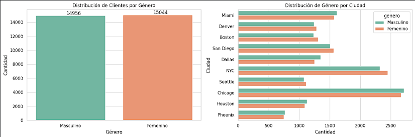

**Género (gráfico 1):** la base está prácticamente **balanceada**: 14 956 clientes masculinos frente a 15 044 femeninos (49.9 % y 50.1 %).

**Género por ciudad (gráfico 2):**

- **Chicago** y **NYC** son las ciudades con más clientes; **Phoenix** es la que tiene menos.
- En todas las ciudades las diferencias entre géneros son pequeñas (la mayor es de 127 clientes, en NYC).
- Predominan los **hombres** en Dallas, Chicago, Miami, Houston y Phoenix, y las **mujeres** en NYC, Boston, San Diego, Denver y Seattle.

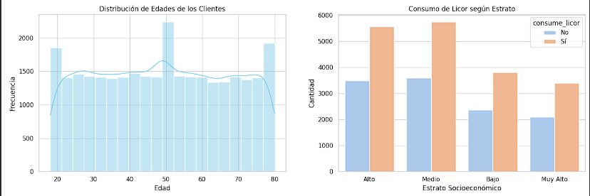

**Edades (gráfico 3):**

- La distribución es **aproximadamente uniforme** entre los 18 y los 80 años, con alrededor de 1 400 a 1 500 clientes por intervalo.
- Hay tres picos: en los extremos (≈ 18 y ≈ 80 años) y cerca de los **50 años**. Al revisar los datos, la explicación es la siguiente:
  - **Efecto del histograma (los tres picos):** las edades son números enteros y el histograma usa 20 intervalos de 3.1 años de ancho. Por eso 17 intervalos contienen 3 edades distintas y 3 intervalos (el primero, el que empieza en 49 y el último) contienen **4**, y esos son justo los que se ven más altos. No es un comportamiento real de los clientes.
  - **Efecto de la imputación (pico central):** se imputaron **308 edades** con la mediana (207 imposibles y 101 nulas), por lo que la edad **49** aparece 812 veces, frente a unas 470 de sus edades vecinas. Eso refuerza el pico del centro.

> **Cómo evitar el efecto del histograma:** usar un intervalo por edad con `sns.histplot(data=df_limpio, x='edad', discrete=True, kde=True)`. Así se ve una distribución plana con un único pico real en la edad 49.

**Consumo de licor según estrato (gráfico 4):**

- En **todos los estratos** hay más clientes que consumen licor que clientes que no.
- Los estratos **Medio** y **Alto** tienen las barras más altas simplemente porque tienen más clientes.
- Al comparar proporciones, el porcentaje de consumidores es prácticamente el mismo en todos los estratos: **Alto 61.5 %, Medio 61.5 %, Bajo 61.7 % y Muy Alto 61.8 %**. El estrato **no parece influir** en el consumo de licor.

> **Nota técnica:** Colab muestra una advertencia `FutureWarning` por usar `palette` sin `hue` en `sns.countplot`. No afecta el resultado. Para evitarla, se puede escribir `sns.countplot(data=df_limpio, x='genero', hue='genero', palette='Set2', legend=False)`.

### 8.7 Boxplot comparativo y diagrama de torta

Se crea una segunda figura de 2 × 2 en la que solo se usan dos posiciones: el **boxplot** de edad (arriba a la derecha) y el **diagrama de torta** de tipo de pago (abajo a la izquierda). Los otros dos espacios se ocultan con `axis('off')`.

```python
# ==========================================
#  PUNTO 3.1: BOXPLOT COMPARATIVO Y DIAGRAMA DE TORTA
# ==========================================
fig, axes = plt.subplots(2, 2, figsize=(15, 10))

# 2. Boxplot Comparativo (Cuantitativa: Edad Inicial vs Limpia)
# Se usa un DataFrame con dos columnas de nombres distintos para que seaborn dibuje dos cajas
edad_comparacion = pd.DataFrame({
    'Edad Inicial (con atípicos)': df['edad'],
    'Edad Final (Limpia)': df_limpio['edad']
})
sns.boxplot(
    data=edad_comparacion,
    ax=axes[0, 1],
    palette=['salmon', 'lightgreen']
)
axes[0, 1].set_title("Comparación Boxplot de Edad")

# 3. Diagrama de Torta (Cualitativa: Tipo de Pago)
df_limpio['tipo_de_pago_mas_usado'].value_counts().plot(
    kind='pie', ax=axes[1, 0], autopct='%1.1f%%', startangle=90,
    colors=['#ff9999','#66b3ff','#99ff99','#ffcc99']
)
axes[1, 0].set_title("Distribución por Tipo de Pago")
axes[1, 0].set_ylabel("")

# Ocultar subplots vacíos
axes[0, 0].axis('off')
axes[1, 1].axis('off')

plt.tight_layout()
plt.show()
```

> **Nota:** las dos series de edad se agrupan en un DataFrame con nombres de columna distintos. Si se pasa una lista de dos series que se llaman igual (`'edad'`), seaborn las trata como una sola y dibuja **una única caja** en lugar de dos.

#### 8.7.1 Boxplot comparativo de edad

- **Tipo:** diagrama de caja y bigotes, con dos cajas lado a lado.
- **Objetivo:** mostrar el efecto de la limpieza sobre la variable `edad`.
- **Cómo se construye:** la primera caja usa la edad **original** (`df['edad']`) y la segunda la edad **limpia** (`df_limpio['edad']`). Como `df_limpio` es una copia, `df` conserva los datos originales.

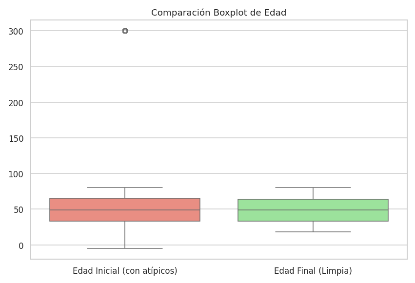

**Interpretación:**

- **Edad inicial:** la base original tenía **207 edades imposibles**: 97 registros con `-5` y 110 con `300`. El `300` aparece como punto atípico en la parte superior del gráfico y el `-5` extiende el bigote inferior por debajo de cero. Por culpa de estos valores la escala llega hasta 300 y la caja se ve aplastada.
- **Edad final (limpia):** los valores imposibles desaparecen y las edades quedan entre **18 y 80 años**. Los datos ya no tienen atípicos.
- **Cuartiles:** la limpieza casi no cambia la forma central de la distribución. La mediana es 49 en ambas cajas, Q1 = 33 en ambas y Q3 pasa de 65 a 64.
- Además, la edad original tenía **101 valores nulos** que se imputaron con la mediana (49).

#### 8.7.2 Diagrama de torta: tipo de pago

- **Tipo:** diagrama circular con porcentajes (`autopct`).
- **Objetivo:** mostrar qué proporción de clientes usa cada medio de pago (variable cualitativa).

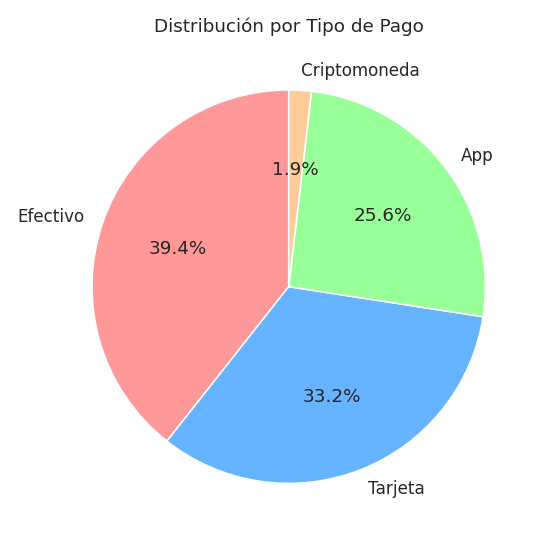

| Tipo de pago | Clientes | Porcentaje |
|---|---|---|
| Efectivo | 11 813 | 39.4 % |
| Tarjeta | 9 954 | 33.2 % |
| App | 7 678 | 25.6 % |
| Criptomoneda | 555 | 1.85 % |

**Interpretación:**

- El **efectivo** sigue siendo el medio de pago más usado (39.4 %), seguido de la **tarjeta** (33.2 %).
- Entre efectivo y tarjeta suman el **72.6 %** de los clientes, y el pago por **app** ya alcanza una cuarta parte (25.6 %).
- Las **criptomonedas** son marginales (1.85 %, 555 clientes).

---

## 9. Resumen de decisiones de limpieza

| Variable | Problema detectado | Solución aplicada | Responsable |
|---|---|---|---|
| `nombre`, `apellido` | Espacios y mayúsculas inconsistentes | `strip()` + `title()` | Andrés |
| `genero` | Diferencias de mayúsculas/minúsculas | `strip()` + `capitalize()` | Andrés |
| `edad` | Valores imposibles (< 18 o > 100) y nulos | Convertir a `NaN` e imputar con la **mediana** | Mora |
| `ciudad_residencia`, `estrato_socioeconomico` | Espacios y formato inconsistente | `strip()` (+ `title()` en estrato) | Mora |
| `promedio_gasto_comida` | Valores nulos | Imputar con la **mediana** | Niko |
| `frecuencia_visita` | Valores negativos | Reemplazar por la **mediana** | Niko |
| `preferencias_alimenticias`, `consume_licor`, `membresia_premium` | Valores nulos | Imputar con la **moda** | Tefa |
| `telefono_contacto` | Formatos mezclados (extensiones, prefijos de país) | Normalizar a `XXX-XXX-XXXX`; nulos → `"Sin registro"` | Camilo |
| `correo_electronico` | Espacios, mayúsculas y nulos | `strip()` + `lower()`; nulos → `"No registrado"` | Camilo |
| `tipo_de_pago_mas_usado` | Formato de texto inconsistente | `strip()` + `capitalize()` | Camilo |
| `ingresos_mensuales` | Sin problemas (rango 800 – 17 999) | Sin cambios | Camilo |

> **Nota:** las operaciones de estandarización de texto (`strip()`, `title()`, `capitalize()`) sobre nombres, género, ciudad, estrato y tipo de pago **no modificaron ningún valor**, porque la base v2 ya tenía esas categorías escritas de forma consistente. Igualmente, `consume_licor` y `membresia_premium` no tenían nulos. Estas líneas funcionan como **validación preventiva**: si llega una versión de la base con errores de formato, el flujo los corrige sin cambiar el código. En cambio, la normalización del teléfono sí transformó **13 691 de los 14 834** números registrados (solo 1 143 venían ya en formato `XXX-XXX-XXXX`).

### 9.1 Registros corregidos en la limpieza

| Variable | Registros afectados | % de 30 000 | Valor de reemplazo |
|---|---|---|---|
| `edad` | 308 (207 imposibles: 97 con `-5` y 110 con `300`; 101 nulos) | 1.0 % | Mediana = 49 |
| `promedio_gasto_comida` | 145 nulos | 0.5 % | Mediana = 25.51 |
| `frecuencia_visita` | 1 547 negativos (todos con valor `-3`) | 5.2 % | Mediana = 4 |
| `preferencias_alimenticias` | 1 403 nulos | 4.7 % | Moda = Carnes |
| `telefono_contacto` | 15 166 nulos | 50.6 % | `"Sin registro"` |
| `correo_electronico` | 15 072 nulos | 50.2 % | `"No registrado"` |

---

## 10. Conclusiones de la limpieza y el análisis exploratorio

1. **Calidad de datos:** la base de 30 000 registros y 17 variables quedó **sin valores nulos** y con formatos consistentes (texto estandarizado, teléfonos en `XXX-XXX-XXXX`, edades y frecuencias dentro de rangos válidos).
2. **Perfil de los clientes:** hay equilibrio de género (≈ 50 % y 50 %), las edades van de 18 a 80 años con una distribución casi uniforme, y la mayor concentración está en Chicago y NYC.
3. **Consumo:** el gasto en comida y los ingresos tienen distribuciones sesgadas a la derecha; el efectivo es el medio de pago más usado (39.4 %), seguido de tarjeta (33.2 %) y app (25.6 %), y el 61.6 % de los clientes consume licor, con una proporción casi idéntica en todos los estratos (61.5 % a 61.8 %).
4. **Limitación principal:** aproximadamente la mitad de los clientes no tiene teléfono ni correo registrado, y solo el 42.8 % tiene membresía premium. Esto indica oportunidades de mejora en la captura de datos de contacto y en la fidelización.
5. **Aspectos a revisar:**
   - La imputación de 308 edades con la mediana refuerza el pico en la edad 49 (812 clientes, frente a unos 470 en las edades vecinas). El resto de los picos del histograma se debe al ancho de los intervalos.
   - **1 463 clientes (4.9 %) tienen un gasto promedio de 0** en la base original. No son nulos imputados, así que conviene validar con quien administra la base si son datos reales.
   - La imputación con la moda infló la preferencia **Carnes**: sin imputar tenía 7 916 clientes (27.7 % de los registros con dato) y tras imputar 1 403 nulos pasó a 9 319 (31.1 %).

---

## 11. Fase II: Probabilidad

Las probabilidades se calcularon con la base ya limpia (N = 30.000 clientes) usando la definición clásica. Como se estiman a partir de una muestra, representan el comportamiento observado de los clientes y no un valor exacto de la población.

### 11.1 Fórmulas utilizadas

$$
P(A) = \frac{n(A)}{N}
\qquad\qquad
P(A \mid B) = \frac{P(A \cap B)}{P(B)} = \frac{n(A \cap B)}{n(B)}
$$

$$
P(A \cup B) = P(A) + P(B) - P(A \cap B)
\qquad \text{(si } A \text{ y } B \text{ son excluyentes, } P(A \cap B) = 0\text{)}
$$

$$
A \text{ y } B \text{ son independientes} \iff P(A \cap B) = P(A)\,P(B) \iff P(A \mid B) = P(A)
$$

Para confirmar la independencia (ejercicios g y h) se usó además la **prueba chi-cuadrado de independencia**, con $H_0$: las variables son independientes y $\alpha = 0{,}05$:

$$
\chi^2 = \sum_{i}\sum_{j} \frac{(O_{ij} - E_{ij})^2}{E_{ij}}, \qquad E_{ij} = \frac{(\text{total fila } i)(\text{total columna } j)}{N}
$$

### 11.2 Resultados por ejercicio

#### a) Preferencia alimenticia

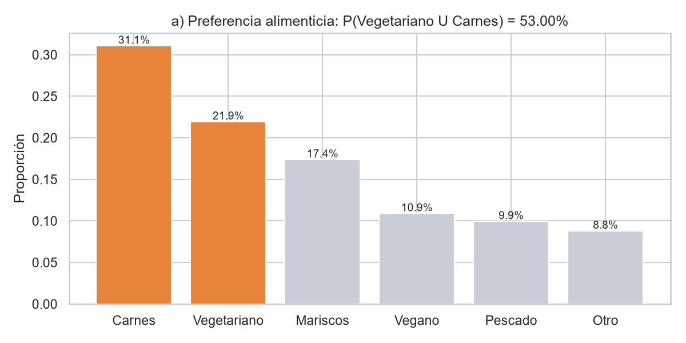

La probabilidad de que un cliente elegido al azar sea vegetariano o prefiera carnes es del **53,00 %** (21,93 % vegetarianos y 31,06 % carnes). Se suman directamente porque son eventos mutuamente excluyentes: cada cliente tiene una única preferencia. Más de la mitad de la clientela se concentra en estas dos categorías, y el resto se reparte entre las demás preferencias de la base. Hay que tener en cuenta que en la limpieza los nulos de esta variable se imputaron con la moda ("Carnes"), lo que aumenta algo P(Carnes): con solo los datos válidos sería 27,68 %, y la unión bajaría a 50,69 %.

$$
P(V \cup C) = P(V) + P(C) = \frac{6\,580}{30\,000} + \frac{9\,319}{30\,000} = 0{,}2193 + 0{,}3106 = 0{,}5300
$$

#### b) Membresía Premium

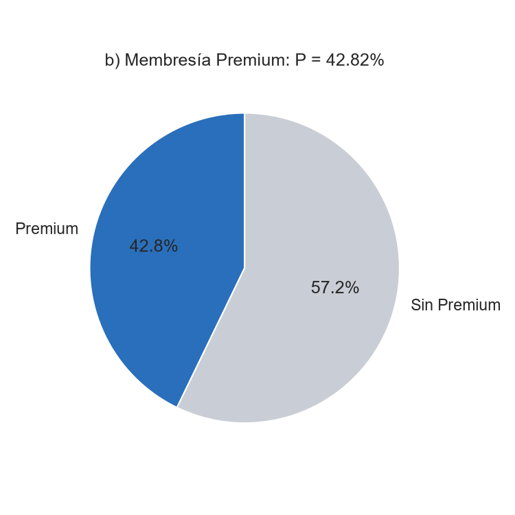

La probabilidad de que un cliente tenga membresía Premium es del **42,82 %**. Casi 4 de cada 10 clientes ya participan en el programa de fidelización, lo que indica una adopción considerable.

$$
P(\text{Premium}) = \frac{12\,845}{30\,000} = 0{,}4282
$$

#### c) Consumo de licor

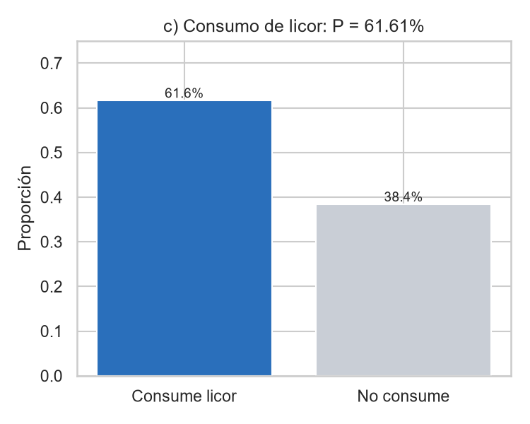

La probabilidad de que un cliente consuma licor al visitar un restaurante es del **61,61 %**. Es la característica más frecuente entre las analizadas, por lo que la oferta de bebidas alcohólicas es un componente importante del negocio.

$$
P(L) = \frac{18\,483}{30\,000} = 0{,}6161
$$

#### d) Premium dado estrato Alto

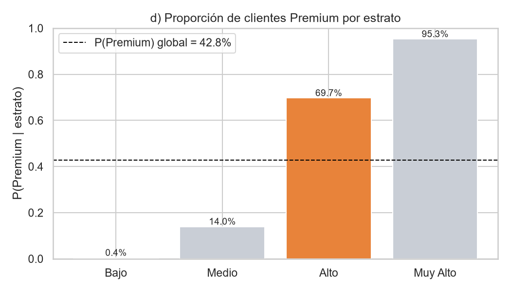

Si el cliente pertenece al estrato Alto, la probabilidad de que tenga membresía Premium sube a **69,71 %**, frente al 42,82 % del total de clientes. Esta diferencia indica que la membresía es mucho más frecuente en este estrato, de modo que el estrato Alto es un perfil clave para el programa de fidelización. Si se agruparan los estratos Alto y Muy Alto, la probabilidad sería del 79,35 %. El gráfico muestra que la probabilidad de ser Premium **crece con el estrato**: 0,4 % en Bajo, 14,0 % en Medio, 69,7 % en Alto y 95,3 % en Muy Alto. Este resultado es clave para la Etapa 3 (sección 12.3).

$$
P(\text{Premium} \mid \text{Alto}) = \frac{n(\text{Premium} \cap \text{Alto})}{n(\text{Alto})} = \frac{6\,300}{9\,038} = 0{,}6971
$$

#### e) Ingresos dado consumo de licor

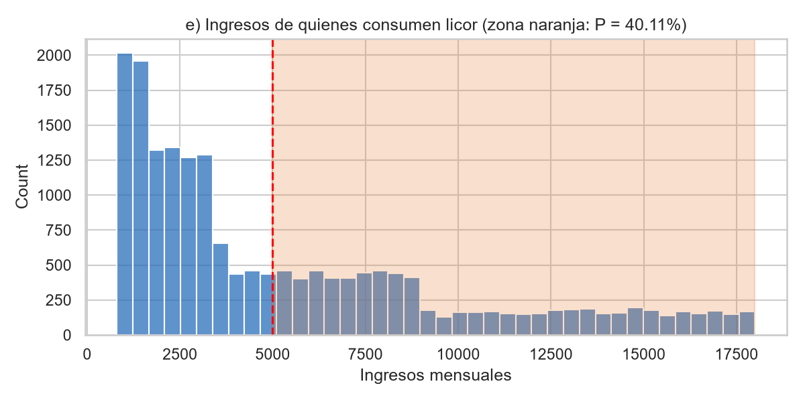

Entre quienes consumen licor, la probabilidad de que sus ingresos mensuales superen $5.000 es del **40,11 %**. Cerca de 4 de cada 10 consumidores de licor tienen ingresos superiores a ese umbral, así que el consumo de licor no se concentra solo en los clientes de mayores ingresos. De hecho, en toda la base P(Ingresos > 5.000) = 40,04 %, prácticamente igual: **el consumo de licor no depende del nivel de ingresos**, lo que coincide con el resultado del ejercicio g.

$$
P(I > 5\,000 \mid L) = \frac{7\,413}{18\,483} = 0{,}4011
$$

#### f) Mariscos dado género femenino

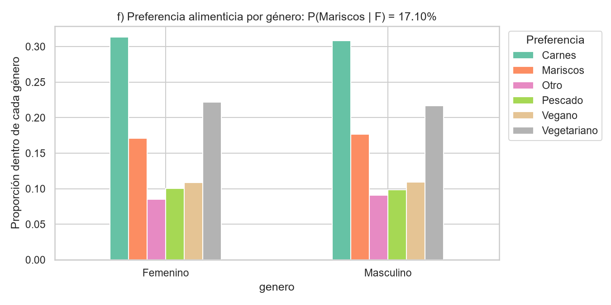

La probabilidad de que una clienta prefiera la categoría Mariscos es del **17,10 %**. En el gráfico se ve que los perfiles de hombres y mujeres son prácticamente iguales en todas las categorías (en hombres, P(Mariscos | Masculino) = 17,65 %), así que **el género no cambia la preferencia alimenticia**. Esta probabilidad sirve como referencia para la oferta de platos, pero no justifica promociones diferenciadas por género.

$$
P(\text{Mariscos} \mid \text{Femenino}) = \frac{2\,573}{15\,044} = 0{,}1710
$$

#### g) Independencia entre licor y estrato Alto

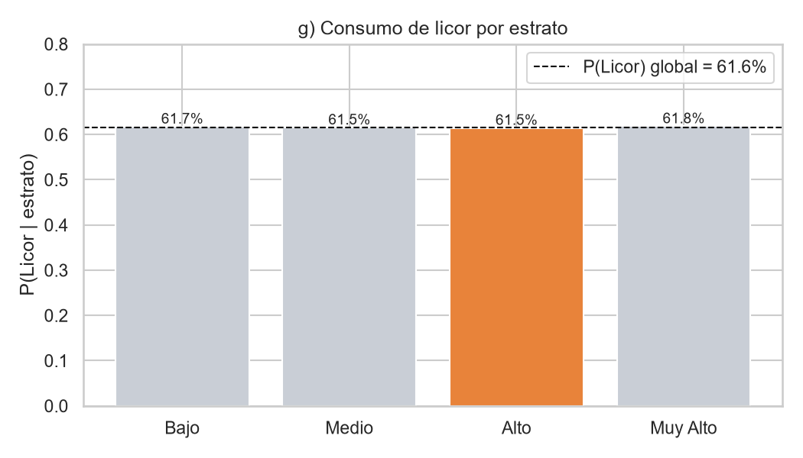

Se verificó si P(Licor ∩ Alto) = P(Licor) × P(Alto). Los valores obtenidos fueron 0,18517 y 0,18561, prácticamente iguales. Además, P(Licor | Alto) = 61,46 % es casi idéntica a P(Licor) = 61,61 %, y la prueba chi-cuadrado (p = 0,970 > 0,05) no rechaza la independencia. Por tanto, **el consumo de licor es independiente del estrato socioeconómico**: saber que un cliente es de estrato Alto no cambia la probabilidad de que consuma licor.

$$
P(L \cap A) = 0{,}18517 \;\approx\; P(L)\,P(A) = 0{,}6161 \times 0{,}3013 = 0{,}18561 \qquad \chi^2 = 0{,}244,\; gl = 3,\; p = 0{,}970
$$

#### h) Forma de pago y membresía

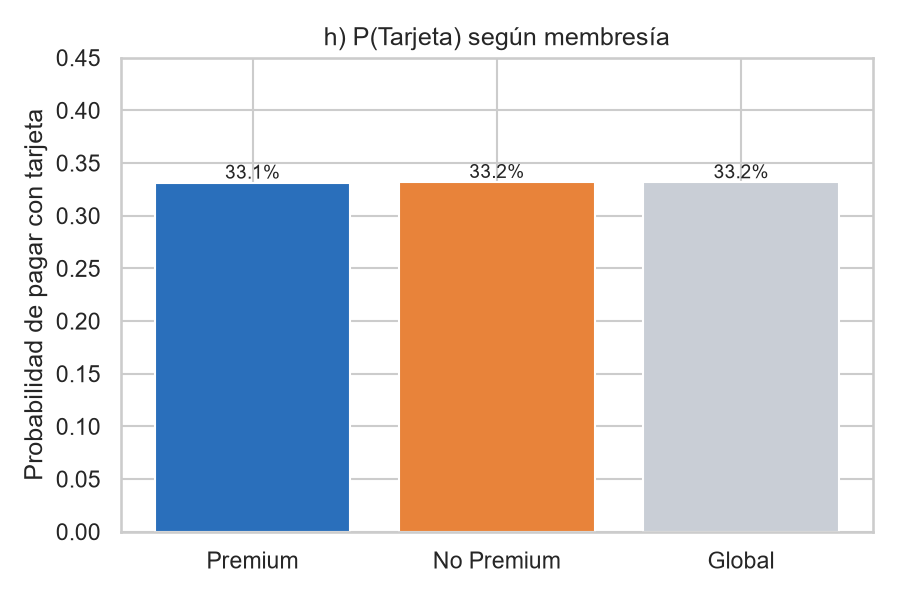

La probabilidad de pagar principalmente con tarjeta es de 33,14 % entre los clientes Premium, 33,21 % entre los no Premium y 33,18 % en general. Las tres son casi iguales y la prueba chi-cuadrado (p = 0,912 > 0,05) no rechaza la independencia, por lo que **el uso de tarjeta no depende de tener membresía Premium**. La membresía no cambia el hábito de pago de los clientes.

$$
P(T \mid \text{Premium}) = 0{,}3314 \;\approx\; P(T \mid \text{No Premium}) = 0{,}3321 \;\approx\; P(T) = 0{,}3318 \qquad \chi^2 = 0{,}0123,\; gl = 1,\; p = 0{,}912
$$

#### i) Carnes o pago en Efectivo

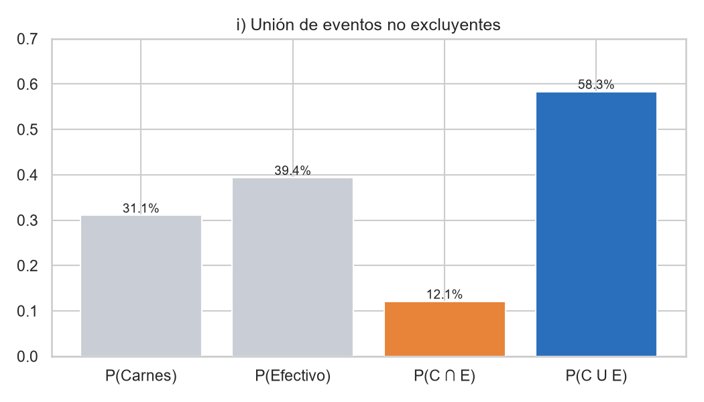

Estos eventos no son excluyentes, porque hay clientes que prefieren carnes y además pagan en efectivo (12,09 %). Por eso se resta la intersección para no contarla dos veces: P(C ∪ E) = 0,3106 + 0,3938 − 0,1209 = **58,35 %**. Además, si los dos eventos fueran independientes se esperaría P(C) × P(E) = 0,1223, muy cerca de la intersección observada (0,1209): la preferencia por carnes tampoco influye en el medio de pago.

$$
P(C \cup E) = P(C) + P(E) - P(C \cap E) = 0{,}3106 + 0{,}3938 - 0{,}1209 = 0{,}5835
$$

#### j) Segmento de edad

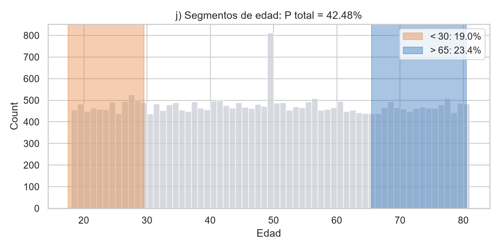

La probabilidad de que un cliente sea menor de 30 años es de 19,04 % y mayor de 65 años de 23,44 %. Como no pueden darse a la vez, se suman: **42,48 %**. Cerca del 42 % de la clientela está en los extremos de edad (jóvenes y adultos mayores), lo que vuelve relevante diseñar ofertas para ambos segmentos.

$$
P(E < 30 \cup E > 65) = P(E<30) + P(E>65) = 0{,}1904 + 0{,}2344 = 0{,}4248
$$

### 11.3 Resumen de la Fase II

| Ej. | Evento | Tipo | Resultado |
|---|---|---|---|
| a | Vegetariano ∪ Carnes | Unión de eventos excluyentes | 53,00 % |
| b | Premium | Probabilidad simple | 42,82 % |
| c | Consume licor | Probabilidad simple | 61,61 % |
| d | Premium \| Alto | Condicional | 69,71 % |
| e | Ingresos > 5.000 \| Licor | Condicional | 40,11 % |
| f | Mariscos \| Femenino | Condicional | 17,10 % |
| g | Licor y estrato Alto | Independencia | Independientes (p = 0,970) |
| h | Tarjeta y Premium | Independencia | Independientes (p = 0,912) |
| i | Carnes ∪ Efectivo | Unión de eventos no excluyentes | 58,35 % |
| j | Edad < 30 ∪ Edad > 65 | Unión de eventos excluyentes | 42,48 % |

### 11.4 Conclusión de la Fase II

La clientela se caracteriza por un alto consumo de licor (61,61 %) y una adopción importante de la membresía Premium (42,82 %), especialmente entre el estrato Alto (69,71 %). El **estrato socioeconómico** es la variable que más diferencia a los clientes, porque la membresía Premium depende fuertemente de él. En cambio, el consumo de licor y el uso de tarjeta se comportan de forma independiente del estrato y de la membresía, respectivamente. Para el negocio, esto indica que las estrategias de fidelización deberían enfocarse en los perfiles de estrato alto, mientras que las decisiones sobre medios de pago o la oferta de licor no necesitan segmentarse por esas variables.


---

## 12. Etapa 3: Modelos de probabilidad

### 12.1 Distribución uniforme continua (edad)

Se modela la edad como $X \sim U(a, b)$ con $a = 18$ y $b = 80$. La probabilidad de un intervalo se calculó con la fórmula y con `scipy.stats.uniform` (ambos coinciden), y la probabilidad real se obtuvo con `between()` sobre la columna `edad`.

$$
f(x) = \frac{1}{b-a} = \frac{1}{62} \approx 0{,}0161, \quad 18 \le x \le 80
\qquad\qquad
P(x_1 \le X \le x_2) = \frac{x_2 - x_1}{b - a}
$$

Los momentos teóricos del modelo coinciden con los de la base limpia (media 48,92 y desviación 18,07):

$$
E[X] = \frac{a+b}{2} = 49 \qquad\qquad \sigma = \frac{b-a}{\sqrt{12}} = \frac{62}{\sqrt{12}} \approx 17{,}90
$$

| Intervalo | Cálculo | P teórica | Clientes reales | P real | Diferencia |
|---|---|---|---|---|---|
| [25, 40] | 15/62 | 24,19 % | 7.607 | 25,36 % | +1,16 pp |
| [40, 60] | 20/62 | 32,26 % | 10.371 | 34,57 % | +2,31 pp |
| [18, 24] | 6/62 | 9,68 % | 3.261 | 10,87 % | +1,19 pp |

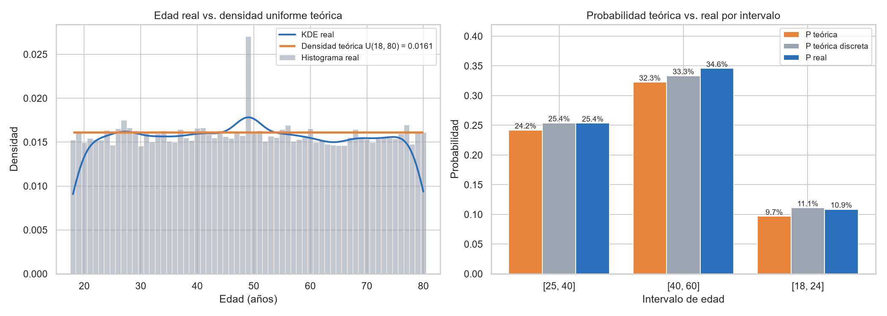


**Por qué la real es ligeramente mayor.** La edad se registra en números enteros y `between()` incluye ambos extremos. En [25, 40] hay 16 edades posibles (25, 26, …, 40), pero el modelo continuo mide un ancho de 15. Al contar 16 de 63 edades posibles se obtiene 25,40 %, casi idéntico al 25,36 % observado. En [40, 60] influye además la limpieza: las 308 edades nulas o imposibles se rellenaron con un valor central, y por eso la edad 49 aparece 812 veces frente a un promedio de 476 por edad.

**Bondad de ajuste.** La prueba chi-cuadrado de uniformidad sobre las 63 edades da χ² = 294,2 con p = 6,6 × 10⁻³², así que formalmente **se rechaza la uniformidad exacta**. Sin embargo, con 30.000 datos la prueba detecta cualquier desviación pequeña, y la principal es el pico artificial de la edad 49 que dejó la limpieza.

**Conclusión.** El modelo uniforme se ajusta bien a la realidad como aproximación (diferencias de 1 a 2,3 puntos porcentuales): ningún grupo de edad domina la clientela. **Para el negocio:** las campañas, el menú y la música no deben diseñarse para un solo grupo etario. Además, el modelo permite estimar el alcance de una promoción por edad; por ejemplo, una dirigida a jóvenes de 18 a 24 años llegaría a cerca del 10 % de los clientes.

### 12.2 Distribución de Poisson (frecuencia de visita)

Se modela $X$ = número de visitas al mes como $X \sim \text{Poisson}(\lambda)$, y se estima λ con la media muestral: **λ = 4,2571 visitas al mes**. Para "más de 8" se usa la regla del complemento.

$$
P(X = k) = \frac{e^{-\lambda}\,\lambda^{k}}{k!}
\qquad\qquad
P(X = 2) = \frac{e^{-4{,}2571}\,(4{,}2571)^2}{2!} = 0{,}1283
$$

$$
P(X > 8) = 1 - P(X \le 8) = 1 - \sum_{k=0}^{8} \frac{e^{-\lambda}\lambda^{k}}{k!} = 1 - 0{,}9700 = 0{,}0300
$$

| Evento | P teórica (Poisson) | Clientes reales | P real |
|---|---|---|---|
| Exactamente 2 visitas | 12,83 % | 3.659 | 12,20 % |
| Más de 8 visitas | 3,00 % | 1.715 | 5,72 % |

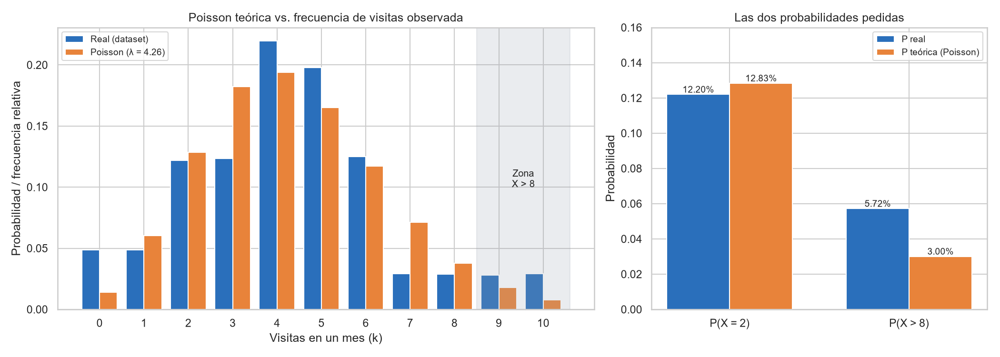


**Evaluación del ajuste.** Una Poisson exige que media y varianza sean iguales ($E[X] = \operatorname{Var}(X) = \lambda$). Aquí:

$$
\text{Índice de dispersión} = \frac{s^2}{\bar{x}} = \frac{4{,}9338}{4{,}2571} = 1{,}159 > 1
$$

Es decir, los datos están algo más dispersos de lo que el modelo supone. En el centro el modelo funciona bien (diferencia de 0,64 puntos en P(X = 2)), pero **subestima la cola derecha**: predice 3,00 % de clientes con más de 8 visitas y en la realidad hay 5,72 %, casi el doble. La razón es que en los datos las visitas 7, 8, 9 y 10 pesan casi lo mismo (alrededor de 2,9 % cada una), mientras que en la Poisson la probabilidad cae rápidamente. También hay un exceso de clientes con 0 visitas (4,88 % real frente a 1,42 % del modelo): son 1.463 registros que además tienen gasto 0 y son de estrato Bajo. La prueba chi-cuadrado de bondad de ajuste (χ² = 5.196,4; gl = 9) rechaza el ajuste exacto (p ≈ 0), aunque con 30.000 registros cualquier desviación pequeña resulta significativa. Por tanto, el modelo se ajusta **de forma aproximada**.

**Para el negocio.** Sirve para estimar la demanda típica y planear personal, inventario y reservas. No debe usarse para dimensionar los picos: los clientes muy frecuentes (más de 8 visitas al mes, 5,7 % de la base) son casi el doble de lo que prevé el modelo, así que conviene tratarlos como un segmento propio en los programas de fidelización y tener margen de inventario.

### 12.3 Distribución normal, Teorema del Límite Central y prueba de hipótesis (gasto en comida)

**Pregunta:** ¿los clientes con membresía Premium gastan más por visita que los clientes sin membresía?

**Hipótesis (prueba unilateral derecha):**

$$
H_0:\; \mu_{\text{Premium}} - \mu_{\text{No Premium}} \le 0 \quad \text{(el programa no aumenta el gasto)}
$$

$$
H_1:\; \mu_{\text{Premium}} - \mu_{\text{No Premium}} > 0 \quad \text{(los Premium gastan más)}
$$

**Nivel de significancia:** $\alpha = 0{,}05$ → valor crítico $z_{0{,}95} = 1{,}645$. Se rechaza $H_0$ si el estadístico supera 1,645 o, de forma equivalente, si el p-valor es menor que 0,05.

| Grupo | n | Media | Desv. estándar | Varianza | Asimetría |
|---|---|---|---|---|---|
| Premium | 12.845 | $47,39 | $29,64 | 878,70 | 0,91 |
| No Premium | 17.155 | $21,47 | $16,38 | 268,17 | 1,48 |

La varianza Premium es 3,28 veces la del otro grupo (Levene: p ≈ 0), así que las varianzas no son iguales.

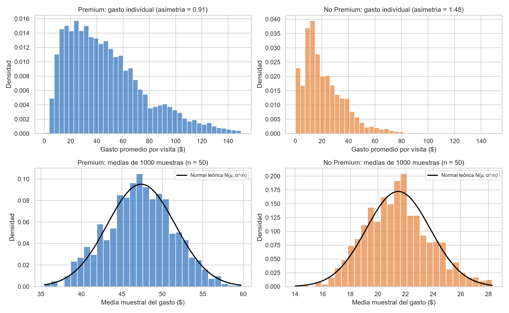


**Teorema del Límite Central.** Para muestras de tamaño $n$ suficientemente grande, la media muestral se distribuye aproximadamente normal, sin importar la forma de la población:

$$
\bar{X}_n \;\approx\; N\!\left(\mu,\; \frac{\sigma^2}{n}\right)
\qquad\Longleftrightarrow\qquad
Z = \frac{\bar{X}_n - \mu}{\sigma/\sqrt{n}} \;\approx\; N(0, 1)
$$

El gasto individual no es normal (asimetría de 0,91 y 1,48). Se simularon 1.000 muestras aleatorias de n = 50 en cada grupo: la asimetría de las medias muestrales baja a −0,02 (Premium) y 0,24 (No Premium), y el error estándar simulado (4,14 y 2,37) coincide con el teórico σ/√n (4,19 y 2,32). Los promedios forman campanas normales aunque los datos individuales no lo sean, lo que valida usar métodos basados en la normal.

**Estadístico de prueba (t de Welch)** y sus grados de libertad (Welch–Satterthwaite):

$$
t = \frac{\bar{x}_1 - \bar{x}_2}{\sqrt{\dfrac{s_1^2}{n_1} + \dfrac{s_2^2}{n_2}}}
= \frac{47{,}39 - 21{,}47}{\sqrt{\dfrac{878{,}70}{12\,845} + \dfrac{268{,}17}{17\,155}}}
= \frac{25{,}91}{0{,}2899} \approx 89{,}39
$$

$$
gl = \frac{\left(\dfrac{s_1^2}{n_1} + \dfrac{s_2^2}{n_2}\right)^2}{\dfrac{(s_1^2/n_1)^2}{n_1 - 1} + \dfrac{(s_2^2/n_2)^2}{n_2 - 1}} \approx 18\,655
$$

**Comparación de estadísticos:**

| Prueba | Estadístico | Grados de libertad | Valor crítico (α = 0,05) | p-valor | Decisión |
|---|---|---|---|---|---|
| t de Welch | 89,39 | 18.655 | 1,645 | ≈ 0 | Rechaza H₀ |
| t de Student | 96,50 | 29.998 | 1,645 | ≈ 0 | Rechaza H₀ |
| Normal Z | 89,39 | — | 1,645 | ≈ 0 | Rechaza H₀ |

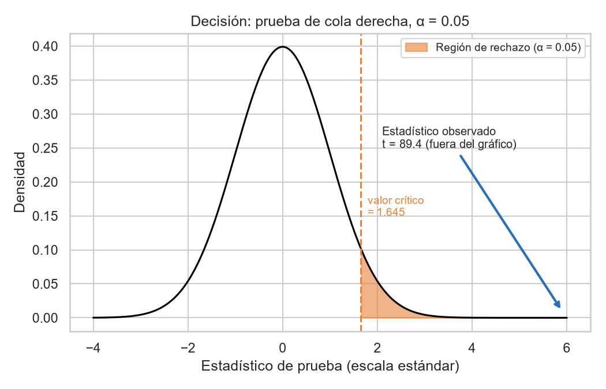


**Por qué la t de Welch es la más rigurosa.**
1. Las varianzas son distintas (la de Premium es más de 3 veces mayor). Student las combina en una sola, y como el grupo de mayor varianza es además el más pequeño, subestima el error estándar: por eso su estadístico sale inflado (96,50 frente a 89,39).
2. Los tamaños muestrales son desiguales (12.845 frente a 17.155), lo que agrava ese problema.
3. Las varianzas poblacionales son desconocidas. El estadístico Z exige conocerlas; aquí coincide con Welch solo porque las muestras son muy grandes.

**Decisión.** El p-valor es prácticamente 0, muy inferior a 0,05: **se rechaza H₀**. Los clientes Premium gastan en promedio más por visita ($47,39 frente a $21,47). La diferencia es de **$25,91** (IC 95 %: $25,34 a $26,48), con un tamaño del efecto grande (d de Cohen = 1,08):

$$
\text{IC}_{95\%} = (\bar{x}_1 - \bar{x}_2) \pm 1{,}96\sqrt{\frac{s_1^2}{n_1} + \frac{s_2^2}{n_2}} = 25{,}91 \pm 0{,}57
\qquad
d = \frac{\bar{x}_1 - \bar{x}_2}{\sqrt{(s_1^2 + s_2^2)/2}} = 1{,}08
$$

 El resultado no cambia al excluir los 145 gastos imputados (t = 89,47) ni con la prueba no paramétrica de Mann-Whitney.

**Advertencia clave: confusión por el estrato socioeconómico.**

> **Aclaración:** aquí "confusión" no se refiere a una *matriz de confusión* de un modelo de clasificación. Se refiere a una **variable de confusión**: una tercera variable (el estrato) que está relacionada a la vez con la membresía y con el gasto, y que puede hacer parecer que la membresía causa el mayor gasto.

 En la Etapa 2 se encontró que la membresía depende fuertemente del estrato: el **89,66 %** de los clientes Premium son de estrato Alto o Muy Alto. Como el estrato también determina cuánto se gasta, la comparación anterior mezcla el efecto de la membresía con el del nivel socioeconómico. Al comparar dentro de cada estrato:

| Estrato | n Premium | n No Premium | Gasto Premium | Gasto No Premium | Diferencia | p-valor |
|---|---|---|---|---|---|---|
| Bajo | 27 | 6.134 | $9,20 | $8,94 | +$0,27 | 0,40 |
| Medio | 1.301 | 8.024 | $24,87 | $24,15 | +$0,72 | 0,015 |
| Alto | 6.300 | 2.738 | $38,13 | $37,89 | +$0,24 | 0,29 |
| Muy Alto | 5.217 | 259 | $64,38 | $61,99 | +$2,39 | 0,14 |

La diferencia ajustada se calcula como el promedio de las diferencias dentro de cada estrato, ponderado por el peso $w_k = N_k / N$ de cada estrato:

$$
\hat{\Delta}_{\text{ajustada}} = \sum_{k=1}^{4} w_k\,\left(\bar{x}_{\text{Premium},k} - \bar{x}_{\text{No Premium},k}\right) = \$0{,}79
\qquad
1 - \frac{0{,}79}{25{,}91} \approx 97\,\%
$$

La diferencia ajustada por estrato es de solo **$0,79** (IC 95 %: −$0,18 a $1,75; p = 0,055): el estrato explica cerca del 97 % de la diferencia observada. La única diferencia estadísticamente significativa es la del estrato Medio, y es de apenas $0,72.

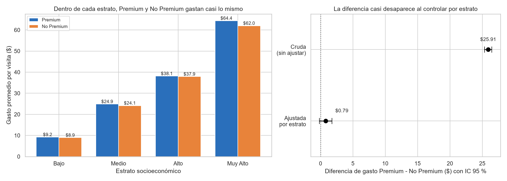

**Conclusión de negocio.** Los clientes Premium gastan mucho más, pero la mayor parte de esa diferencia refleja *quiénes* se hacen Premium (clientes de estratos altos que ya gastaban más), y no un efecto propio de la membresía. Con estos datos observacionales no se puede afirmar que el programa de fidelización *cause* un mayor gasto. Se recomienda al equipo de marketing no atribuirle al programa los $26 de diferencia, evaluar su efectividad comparando clientes del mismo estrato o con una prueba controlada (por ejemplo, ofrecer la membresía de forma aleatoria dentro de cada estrato), y concentrar la captación donde la membresía es poco frecuente, como el estrato Medio.

---
## 13. Conclusiones generales y recomendaciones

1. **Calidad de los datos:** la base quedó completa y consistente sin eliminar registros. Los sesgos de la imputación (pico en la edad 49 e inflación de Carnes) están identificados.
2. **El estrato es la variable que más diferencia a los clientes:** la probabilidad de ser Premium pasa de 0,4 % en el estrato Bajo a 95,3 % en Muy Alto, y el gasto por visita crece con el estrato.
3. **Hábitos transversales:** el consumo de licor (61,61 %), la preferencia alimenticia y el medio de pago no dependen del estrato, del género, de los ingresos ni de la membresía.
4. **Modelos:** la edad se aproxima a una U(18, 80) y la frecuencia de visita a una Poisson(4,26), aunque esta subestima a los clientes muy frecuentes (5,72 % reales frente a 3,00 % del modelo).
5. **Prueba de hipótesis:** los Premium gastan $25,91 más por visita (p ≈ 0), pero el estrato explica cerca del 97 % de esa diferencia. No se puede afirmar que la membresía *cause* el mayor gasto.

**Recomendaciones para los restaurantes:**

- **Fidelización:** concentrar la captación de nuevos Premium en el **estrato Medio** (31,1 % de los clientes, solo 14,0 % Premium) y medir el efecto real del programa comparando clientes del mismo estrato.
- **Oferta:** mantener una carta de licores homogénea en todos los locales y reforzar las opciones vegetarianas y veganas (32,8 % sumadas), además de Carnes.
- **Pagos:** conservar la operación en efectivo (39,4 %) y consolidar el pago por app (25,6 %). El pago con criptomonedas (1,85 %) no justifica una inversión específica.
- **Operación:** planear personal e inventario con λ ≈ 4,26 visitas al mes, dejando margen para el 5,7 % de clientes con más de 8 visitas.
- **Datos:** hacer una campaña de actualización de contactos (≈ 50 % sin teléfono ni correo) y validar los 1.463 registros con gasto y frecuencia en 0.

---

*Fin del documento.*
